<div align="center">

# Microduck Football

**Teaching a 25 cm robot duck to play football in simulation — first with reinforcement learning,
then from its own camera with LeRobot, then two against two.**

[](https://github.com/huggingface/lerobot)
[](https://huggingface.co/datasets/brouthen/microduck-football-rl-camera)
[](https://huggingface.co/datasets/brouthen/microduck-football-obstacles-camera)
[](https://huggingface.co/datasets/brouthen/microduck-football-rl-camera-dagger)
[](https://huggingface.co/brouthen/microduck-football-act)
[](LICENSE)

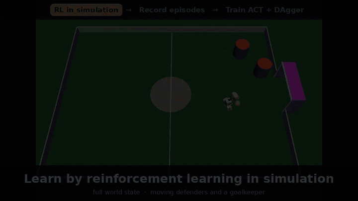
<br><sub>The pipeline in 8 seconds (<a href="assets/media/poc_microduck_football.mp4">mp4</a>). The last clip is an illustration filmed with the RL player; the real camera player is shown in Chapter 3.</sub>

**▶ [Watch the 90-second walkthrough of this README](assets/media/walkthrough.mp4)** — one clip per chapter

</div>

## In one paragraph

The [microduck](https://github.com/pollen-robotics/microduck_rl) is a small two-legged robot from Pollen Robotics.
It already knows how to **walk, stand and kick** — each skill is a small neural network trained by Pollen. We never
touched those skills. Instead, we trained a "coach" on top that decides, five times per second, *which* skill to use.
First, a **reinforcement-learning (RL) player** that can see everything learned to dribble into the goal, then to get
past defenders and a goalkeeper. Then we filmed its games from the duck's own head camera, saved them as
**LeRobot datasets**, and trained a LeRobot **ACT** policy that plays from the **camera only**. Finally, we put
**four ducks** on a bigger pitch and trained them to play **2 vs 2** against each other.

| What we built | What it sees | Trained on | Result |
|---|---|---|---|
| RL player (PPO) | everything (ball, goal, opponents) | open play, then opponents | 20/20 goals in open play · 8/20 vs goalkeeper + 2 defenders |
| Camera player (LeRobot ACT + DAgger) | head camera + body sensors | **open play only — no opponents** | 16/20 goals (12/20 re-measured, see Chapter 3) |
| 2v2 team (MAPPO self-play) | its own view of the game | 2 vs 2 | not there yet: vs a team of RL players, 9 wins, 30 draws, 21 losses (60 games) |

**Contents** — [1 · Rules](#chapter-0--the-rules-we-set-ourselves) · [2 · RL player](#chapter-1--an-rl-player-that-sees-everything) ·
[3 · Camera & dataset](#chapter-2--giving-it-eyes-and-recording-a-lerobot-dataset) · [4 · ACT](#chapter-3--a-player-that-only-uses-its-camera) ·
[5 · 2v2](#chapter-4--two-against-two) · [Summary](#where-we-ended-up) · [Run it](#run-it-yourself) · [Credits](#credits)

---

## Chapter 0 — The rules we set ourselves

* **The robot uses only its real skills.** Every movement comes from Pollen's frozen walking, standing and kicking
  networks (`policies/`), driven exactly like the real robot drives them. The simulation also models the real servo
  motors (friction, battery voltage drop).
* **No cheating helpers.** Nothing pulls the ball to the foot, picks which foot to kick with, or stands the duck back
  up after a fall. The player has to learn all of that.
* **Measure before guessing.** Whenever something failed, we built a small test to find out why before changing the
  method. Every number in this README is traced to its source in [`docs/results.json`](docs/results.json).

The duck's high-level controls are nine buttons: **stand, walk, walk-and-turn left/right, side-step left/right, walk
back, kick left, kick right**. We first tried driving it ourselves with a keyboard. It works, but it is slow and
tiring: walking only starts above a certain speed, turning only works while walking, and a kick only connects if the
duck has settled with the ball a few centimetres in front of its foot. A hand-written strategy did better (6 goals in
16 games against 0 for random play), but not well enough to teach a camera model. So we let reinforcement learning
find the strategy.

<p align="center">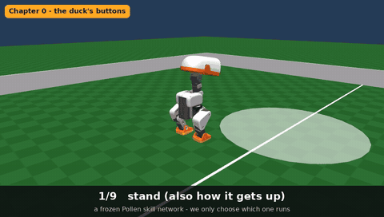<br>
<sub>The nine buttons, one after the other (2×). Each is a frozen Pollen skill network; we only choose which one runs.</sub></p>

## Chapter 1 — An RL player that sees everything

The RL player (PPO) receives the exact positions of the ball, the goal and itself, and is rewarded for moving the ball
towards the goal, for scoring, and penalised for falling.

**Step by step: a curriculum.** Scoring from anywhere is too hard to discover by chance, so the training starts easy:
the ball right in front of the goal. Once the player scores often enough there (60 % of the last 100 games), the next
stage unlocks — the ball a bit further, then behind the duck, then anywhere. We kept the same rule to add
**opponents**: one defender, a wall of three with a gap, two patrolling defenders, then a goalkeeper that gets
faster, and finally a goalkeeper with two defenders.

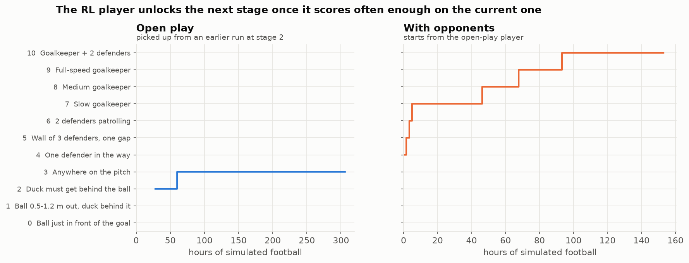

<p align="center">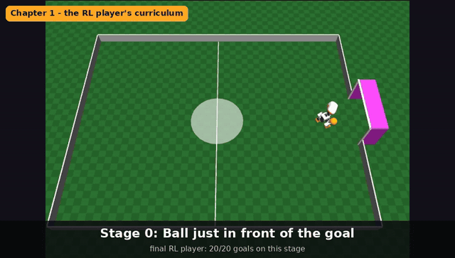<br>
<sub>Every stage, from "ball in front of the goal" to "goalkeeper + 2 defenders", played by the same final RL player.</sub></p>

<table>
<tr>
<td align="center">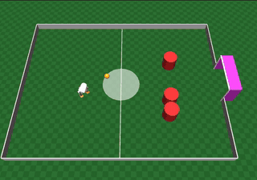<br><sub>Wall of 3 defenders — find the gap</sub></td>
<td align="center">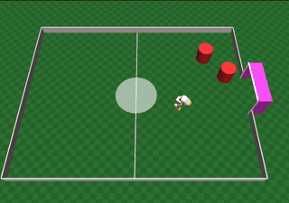<br><sub>2 patrolling defenders</sub></td>
<td align="center">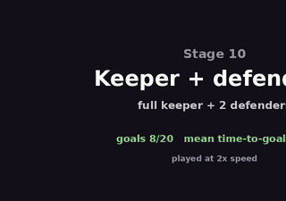<br><sub>Goalkeeper + 2 defenders</sub></td>
</tr>
</table>

One final model plays every stage. It scores almost always in open play and against slow opponents, and it is still
beaten most of the time by the full goalkeeper with two defenders:

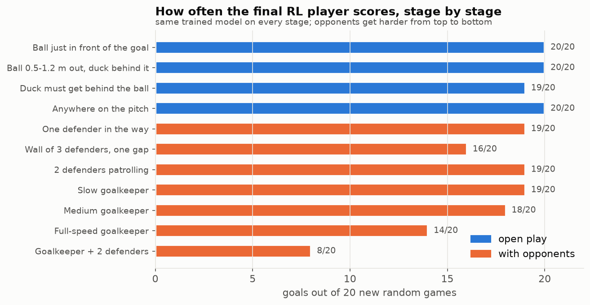

Things we learned on the way:
* **Our first opponents were see-through.** In the first version the defenders were drawn but the ball went through
  them (moving fixed objects in MuJoCo does not move their collision shapes). We caught it in the videos, rebuilt them
  as proper moving bodies, and added a physics test.
* **The full goalkeeper was too hard as one step**, so it became three: slow, medium, full speed.
* **The player dribbles, it never shoots.** The kick turned out to send the ball only about half a metre on this pitch
  (Chapter 4 explains why), so pushing the ball while walking is simply the better strategy.

The full video of every stage is in [`assets/media/showreel_all_stages.mp4`](assets/media/showreel_all_stages.mp4).

## Chapter 2 — Giving it eyes, and recording a LeRobot dataset

A camera player needs the ball in its picture. We added a **head reflex**: the duck's head follows the ball, and every
few seconds it glances at the goal. This changes nothing in how the RL player plays (it still scores), but now its
head camera keeps the ball in view about 79 % of the time and catches the goal about 40 % of the time.

<p align="center">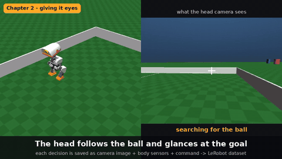<br>
<sub>Left: the game. Right: what the head camera records — it follows the ball, then glances at the goal.</sub></p>

Then we replayed thousands of decisions of the RL player and recorded each one in the **LeRobot dataset format
(v3.0)**: the head-camera image, the duck's body sensors, and the command the RL player chose.

| On the Hugging Face Hub | Situation | Episodes | Frames | Used to train ACT? |
|---|---|---|---|---|
| [`microduck-football-rl-camera`](https://huggingface.co/datasets/brouthen/microduck-football-rl-camera) | open play | 195 | 16 730 | **yes** |
| [`microduck-football-obstacles-camera`](https://huggingface.co/datasets/brouthen/microduck-football-obstacles-camera) | with opponents (all 7 opponent stages) | 66 | 9 362 | not yet — recorded for the next step |
| [`microduck-football-rl-camera-dagger`](https://huggingface.co/datasets/brouthen/microduck-football-rl-camera-dagger) | open play: the 195 games above + 105 DAgger games (Chapter 3) | 300 | 30 431 | **yes — the exact training set of the published model** |

<p align="center">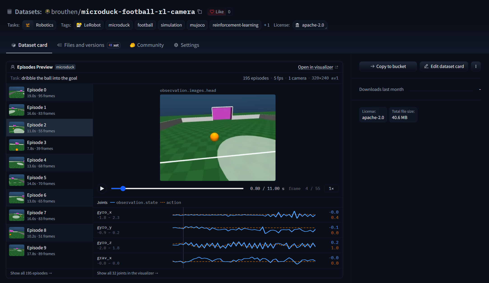</p>

## Chapter 3 — A player that only uses its camera

> **What the camera player was trained on:** open play only — no defenders, no goalkeeper. 195 games of the RL player,
> plus 105 games played by the camera player itself and corrected by the RL player (DAgger, below) — 300 games,
> 30 431 frames ([published here](https://huggingface.co/datasets/brouthen/microduck-football-rl-camera-dagger)). It was tested on
> 20 new open-play games it had never seen.

We trained a LeRobot **ACT** policy: it looks at the head camera and the body sensors and outputs a walking command
(forward speed, sideways speed, turning speed) plus "kick". Here is how it went, attempt by attempt:

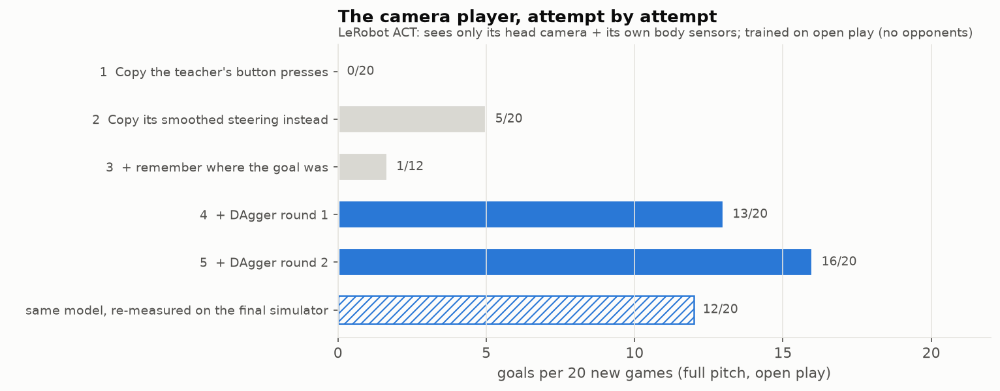

1. **Copying the RL player's buttons: 0/20.** The RL player switches buttons very often (left, right, left…).
   Copying that from pictures is nearly impossible. → We smoothed its commands into steady steering.
2. **Copying smoothed steering: 5/20.** Better, but the camera player often lost the goal and wandered.
3. **Adding a goal memory: 1/12.** The duck remembers where it last saw the goal and updates that guess as it walks
   (with realistic drift, like a real robot's odometry). On its own this did *not* help — which needed an explanation.

**Why copying fails — a cheap experiment.** Instead of guessing, we trained small, fast students without a camera
and gave them different information. Even a student that received **exactly what the RL player sees** scored only
2/20 by copying. So the problem was not missing information: a copying student makes small mistakes, drifts into
situations the RL player never got into, and has no idea what to do there.

The fix is **DAgger**: let the student play, ask the RL player "what would you have done here?" for every moment of
those games, add the answers to the dataset, and retrain. This only works if the student can know where the goal is —
then the goal memory pays off:

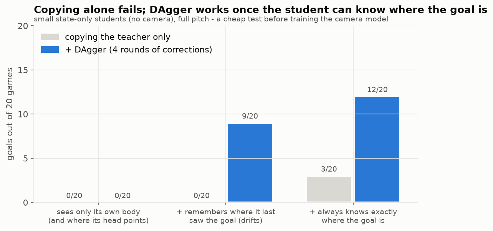

4. **Camera player + DAgger round 1: 13/20**, and it almost stopped falling.
5. **DAgger round 2 (more games starting near the goal): 16/20, no falls.** The remaining failures are stalls with
   the ball less than half a metre from the goal line.

<p align="center">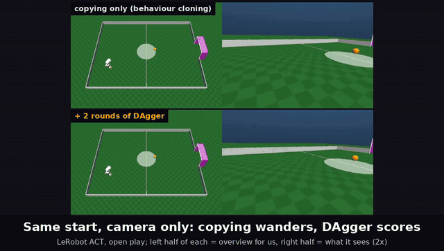<br>
<sub>Same starting position, camera only (2×). Top: copying only — it never scores in 90 s. Bottom: after two DAgger
rounds — it scores in 21 s. In each view, the left half is an overview for us; <b>the right half is the only picture
the player gets.</b></sub></p>

> **An honest re-measurement.** When we re-tested the published model at the very end, on the same 20 games, it
> scored **12/20 (no falls)**. In between, invisible opponent bodies had been added to the simulated scene (parked
> off the pitch, for Chapter 1). That slightly changes the order of MuJoCo's contact computations, and in a bumpy,
> chaotic game like this the same starting position then plays out differently. With only 20 games, ±2 goals is
> normal noise; we report both numbers.

## Chapter 4 — Two against two

**First, the kick.** Passing and shooting need a kick that actually moves the ball, and ours sent it about half a
metre. We measured it carefully: the kick itself is fine (Pollen trained it as a gentle 1 m/s pass) — it was our
grass-like floor that stopped the ball. On an indoor-like floor the same kick travels 1.7 m. The RL player still
scores on that floor, so the 2v2 pitch uses it.

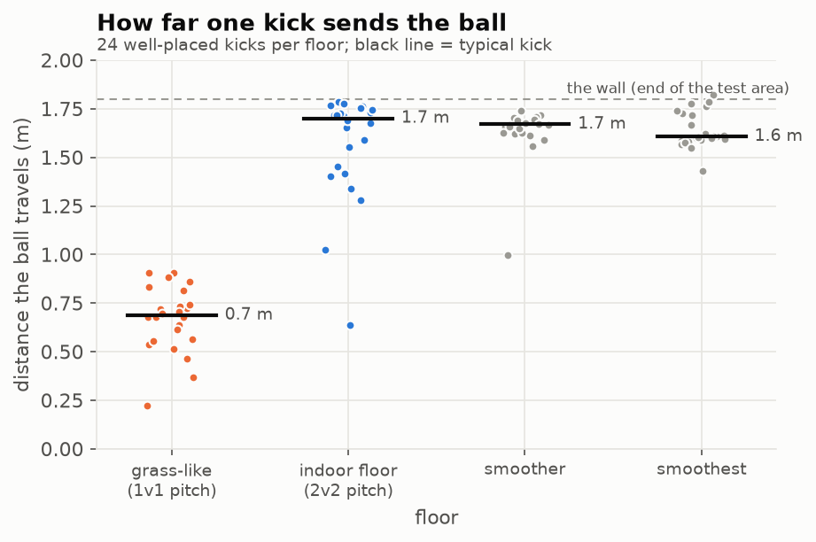

A kick also only connects when the duck stands still with the ball inside a 4 × 6 cm spot — too precise for a
5-times-a-second controller. So we added an **aimed kick** button: a small routine that walks up to the ball, waits
until the duck is steady, and kicks with the right foot. 78 % of aimed kicks send the ball more than half a metre.

<table><tr>
<td align="center">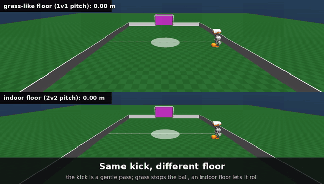<br><sub>The same kick on grass (top) and on an indoor floor (bottom)</sub></td>
<td align="center">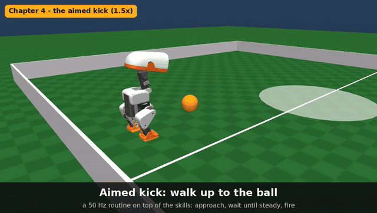<br><sub>The aimed kick: approach, wait until steady, kick</sub></td>
</tr></table>

**Four ducks, one brain.** We built a 3.4 × 2 m pitch with two goals and four ducks that can bump into each other.
Every duck sees the game from its own team's side, so a single network can play blue or red. It starts as a copy of
the RL player and is trained with **MAPPO**: each duck decides from its own view, while a "coach" network that sees
the whole pitch helps during training only. The ducks train by playing against themselves and against older copies
of themselves (a pool, which starts with the original RL player). A copy joins the pool once the current team wins
55 % of games — the same "unlock the next stage" rule as in Chapter 1.

<p align="center">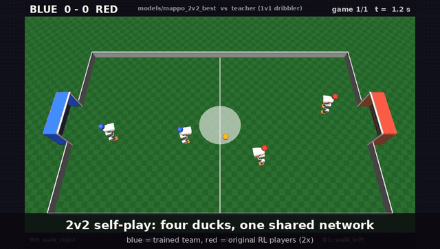<br><sub>A 2v2 game: the trained team (blue) scores against two copies of the original RL player (red). 2×.</sub></p>

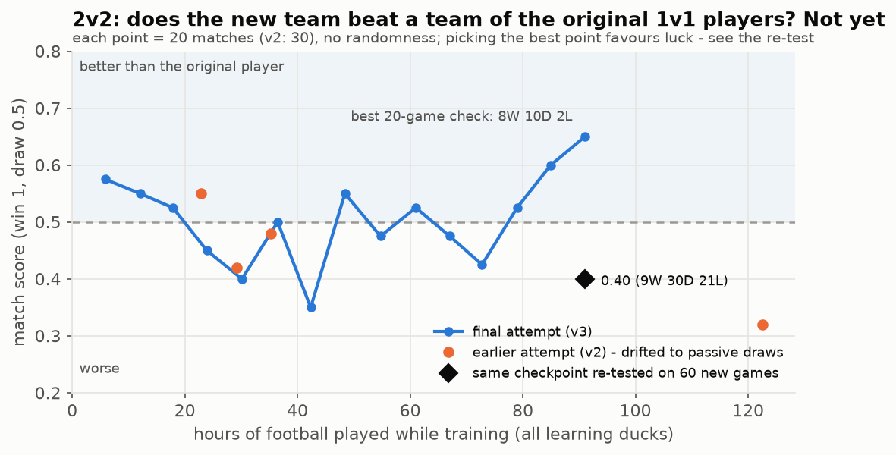

It took three attempts:

| Attempt | What we changed | What happened |
|---|---|---|
| v1 | — | got *worse*: the new "coach" network started from zero and its noisy advice spoiled the copied RL player |
| v2 | train the coach first, keep the player calm | reached 0.55, then learned to play it safe — aimed kicks became a way to stand still, most games ended 0–0 |
| v3 | aimed kick only when the ball is close, draws cost both teams, keep the best checkpoint | its best 20-game check reached 0.65 (8 wins, 10 draws, 2 losses) … |

… but that was a lucky draw. Picking the best of 15 noisy 20-game checks favours luck. **Re-tested on 60 new
games, the same model scores 0.40 — 9 wins, 30 draws, 21 losses — so it is still *worse* than a team of the original
RL players**, and half of its games end 0–0. The checks along the curve above sit between 0.35 and 0.65, which is what
a true level of about 0.45 looks like with 20-game noise. Real passing has not appeared yet: this chapter is the
honest unfinished part of the project, and the setup (four simulated ducks, aimed kick, self-play with a pool) is
ready for longer training.

## Where we ended up

* An **RL player** that dribbles past defenders and a goalkeeper — trained with a simple "unlock the next stage"
  curriculum, using only the robot's real walking and kicking skills.
* **Two public LeRobot datasets** filmed from the robot's own head camera (open play, and with opponents).
* A **LeRobot ACT player that scores from its camera alone** in open play, made possible by DAgger and a goal memory.
* A **2v2 multi-agent setup** — four simulated ducks, an aimed-kick skill and MAPPO self-play — that runs, but does
  not yet beat a team of the original RL players.

**Not done yet:** the camera player has never seen an opponent (the opponent dataset is ready for it); the RL player
dribbles instead of shooting; 2v2 games are still draw-heavy; and everything runs in simulation only.

## Run it yourself

Tested on Linux (WSL2) with Python 3.12, a 6-core laptop CPU, and an RTX 4070 laptop GPU (only needed for ACT).

```bash
git clone --recursive https://github.com/BrouthenKamel/lerobot_microduck.git && cd lerobot_microduck
uv sync                      # installs everything (LeRobot 0.7, MuJoCo, Stable-Baselines3, ...)
uv run pytest                # quick check, ~10 s
export MUJOCO_GL=egl         # render without a screen
```

**Watch the trained players** (small models are included in `models/`):

```bash
# RL player, open play, 10 games
uv run python -m microduck_football.rl.train_teacher eval models/ppo_teacher_open_play.zip --stage 3 --episodes 10
# RL player against 2 patrolling defenders, saved as a video
uv run python -m microduck_football.rl.play_heuristic --model models/ppo_teacher_obstacles.zip --stage 6 --episodes 1 --video rl.mp4
# camera player (downloaded from the Hub), 20 open-play games + a video
uv run python -m microduck_football.tools.download_models
uv run python -m microduck_football.imitation.eval_student models/act_camera_student --stage 3 --episodes 20 --video act.mp4
# 2v2: the trained team against a team of RL players
uv run python -m microduck_football.multiagent.train_2v2 eval models/mappo_2v2_best.pt --games 20
```

**Browse every training run** (curves for all 14 runs of the hackathon, no retraining needed):

```bash
uv run python -m microduck_football.tools.mlflow_io import           # rebuilds runs/mlflow.db from experiments/mlflow/
uv run mlflow ui --backend-store-uri sqlite:///runs/mlflow.db           # http://127.0.0.1:5000
```

The game-by-game evaluation logs behind every number are in [`experiments/logs/eval/`](experiments/logs/eval/).

<details>
<summary><b>Retrain everything</b> (every command has <code>--help</code>; results go to <code>runs/</code>, training curves to MLflow)</summary>

```bash
# Chapter 1 — RL player: open play, then opponents
uv run python -m microduck_football.rl.train_teacher train --run-name ppo_open --total-steps 5_000_000 --advance-at 0.6
uv run python -m microduck_football.rl.train_teacher train --run-name ppo_opp --obstacles --start-stage 4 \
    --warm-start runs/ppo_open/final.zip --advance-at 0.65 --window 200
uv run python -m microduck_football.rl.make_showreel --model runs/ppo_opp/final.zip      # video of every stage

# Chapter 2 — record a LeRobot dataset from the head camera (add --obstacles --stages 4 5 6 7 8 9 10 for opponents)
uv run python -m microduck_football.imitation.gen_dataset --episodes 200 --workers 6 --memory --out data/rl_football_v2
uv run python -m microduck_football.imitation.push_dataset data/rl_football_v2 --name my-dataset --public

# Chapter 3 — ACT, then DAgger rounds
uv run lerobot-train --policy.type=act --dataset.repo_id=local/rl_football_v2 --dataset.root=data/rl_football_v2 \
    --policy.chunk_size=20 --policy.n_action_steps=5 --policy.push_to_hub=false --output_dir=runs/act_r0
uv run python -m microduck_football.imitation.dagger_camera --student runs/act_r0/checkpoints/last/pretrained_model \
    --base data/rl_football_v2 --out data/rl_football_v2_d1 --episodes 45 --near-goal 0.3
#   fine-tune on data/rl_football_v2_d1 (lerobot-train --policy.path=...), repeat, then eval_student
uv run python -m microduck_football.imitation.bc_probe          # the "why copying fails" experiment
uv run python -m microduck_football.imitation.dagger_probe      # the DAgger experiment

# Chapter 4 — kick measurements and 2v2 self-play
uv run python -m microduck_football.rl.kick_lab rolling
uv run python -m microduck_football.multiagent.train_2v2 train --run-name mappo --hours 2 --workers 6 --resume models/mappo_2v2_best.pt
uv run python -m microduck_football.multiagent.play_2v2 --blue runs/mappo/best.pt --red teacher --games 2 --video 2v2.mp4

# figures in this README, and the training dashboard
uv run python -m microduck_football.tools.make_figures
uv run mlflow ui --backend-store-uri sqlite:///runs/mlflow.db
```
</details>

<details>
<summary><b>Technical details</b> (simulator, observations, rewards, model settings)</summary>

**Simulator.** MuJoCo 3.8 (5 ms steps) with BAM models of the Dynamixel XL330 servos — the same actuator model
Pollen used to train the motor skills. The skills run at 50 Hz through their 13-D command interface
(`infer_policy.py` from the `microduck_rl` submodule). Our controller decides at 5 Hz (one decision = 10 motor steps).
1v1 pitch 2.6 × 2.0 m, goal 0.5 × 0.3 m, 70 mm / 15 g ball with rolling friction 0.003 (grass-like); 2v2 pitch
3.4 × 2.0 m with rolling friction 0.0015.

**Buttons (primitives):** stand · walk (v<sub>x</sub> 0.4) · walk + turn (ω ±1) · side-step (v<sub>x</sub> 0.3,
v<sub>y</sub> ±0.3) · back (v<sub>x</sub> −0.4) · kick left / right (0.5 s); 2v2 adds the aimed kick.

**What each player observes**

| Player | Size | Content |
|---|---|---|
| RL player | 29 (+20 with opponents) | ball position and velocity, both goal posts, own position, heading, speed, turn rate, tilt, time standing, kick time left, last button (+ position, velocity and presence of 4 opponents) |
| Camera player (ACT) | image + 32 | 240×320 head camera; gyroscope, tilt, 14 joint angles, last command, time standing, kick time left, goal memory (direction, distance, time since seen), previous head angles |
| 2v2 player / coach | 50 / 86 | the RL player's 29 numbers seen from its team's side + own goal, teammate, 2 nearest opponents / + the whole pitch |

**RL reward** (*b* ball, *g* goal, *d* duck):

$$
r = 2\,\Delta\big(-\lVert b-g\rVert\big) + 0.5\,\Delta\big(-\max(\lVert b-d\rVert-0.2,\,0)\big) + 10\cdot\text{goal} - 1\cdot\text{fall} - 0.005
$$

Rewards on *changes* in distance (Δ) cannot be farmed by walking back and forth. PPO: 2×256 network, γ = 0.995
(≈ 40 s horizon). Curriculum: advance at 60 % goals over 100 games (open play) and 65 % over 200 games (opponents);
25 % of games replay earlier stages so nothing is forgotten.

**Camera player.** LeRobot ACT, ResNet-18 image encoder, predicts 20 future commands and re-plans every 5. Targets are
the RL player's commands smoothed over 0.4 s (the smoothed RL player still scores 20/20). DAgger: student games with
30–50 % starting near the goal; every visited moment relabelled by the RL player; each round fine-tunes the last.

**2v2 (MAPPO).** Shared player network (warm-started from the RL player: its first 29 inputs are identical, new
inputs start at zero — it reproduces the RL player on 240/240 test decisions) + a central coach network used only in
training. Team rewards: goal ±10, moving the ball towards the opponents' goal; the duck closest to the ball is
rewarded for approaching it (the other is free to position); falls −1; draw −3 for both teams.
Fair evaluation: both teams pick their best action (no randomness), sides alternate.
</details>

## Repository layout

```
src/microduck_football/
├── paths.py         where every file lives
├── sim/             the simulated duck (1v1 and 2v2), head reflex, pitch scenes
├── envs/            Gymnasium environments: football with curriculum + opponents, and 2v2
├── agents/          hand-written baseline player
├── rl/              train / evaluate / film the RL player, kick measurements
├── imitation/       record LeRobot datasets, evaluate ACT, DAgger, the "why copying fails" experiments
├── multiagent/      2v2 self-play training and match videos
├── teleop/          drive the duck with a keyboard (and record LeRobot episodes)
└── tools/           figures, model download
models/              trained RL players and 2v2 team (the camera player downloads here)
policies/            Pollen's walking / standing / kicking skills
third_party/         Pollen's microduck_rl (robot model, skill runner) as a git submodule
docs/                figures, animations, results.json (source of every number)
experiments/         every training run (MLflow export) and the evaluation / training logs
assets/media/        videos: every RL stage, 2v2 matches, the camera player
tests/               quick checks
```

## Credits

* **[Pollen Robotics](https://www.pollen-robotics.com/)** — the microduck, its 3D model and meshes (CC BY-NC-SA 4.0,
  downloaded through the [`microduck_rl`](https://github.com/pollen-robotics/microduck_rl) submodule, not included
  here), the skill runner, and the walking / standing / kicking skills in `policies/` (Apache-2.0), trained with
  [mjlab](https://github.com/mujocolab/mjlab).
* **[Hugging Face LeRobot](https://github.com/huggingface/lerobot)** — dataset format, ACT, training scripts, the Hub.
* **[Rhoban BAM](https://github.com/Rhoban/bam)** — the servo motor models.
* **[MuJoCo](https://mujoco.org)**, **[Stable-Baselines3](https://github.com/DLR-RM/stable-baselines3)**,
  **[MLflow](https://mlflow.org)**, **Gymnasium**.

Code under [Apache-2.0](LICENSE). To cite this work, see [`CITATION.cff`](CITATION.cff).
